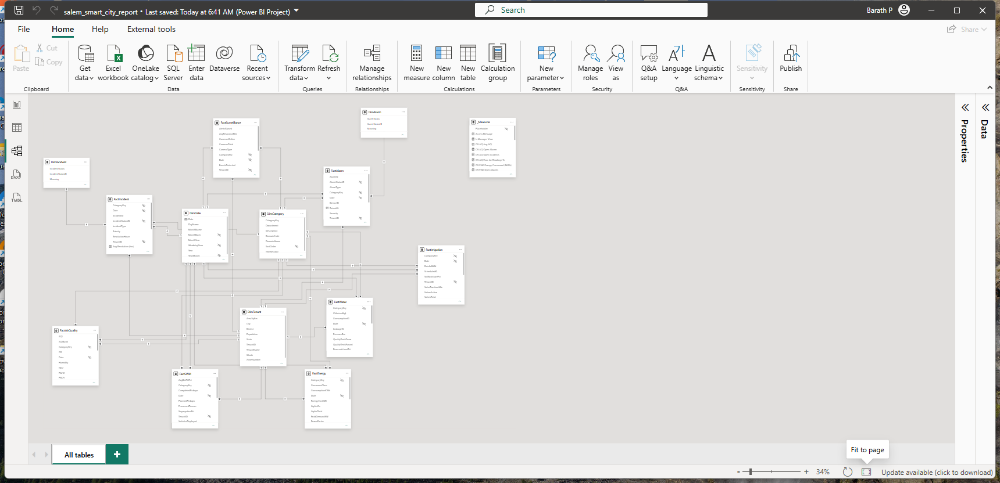
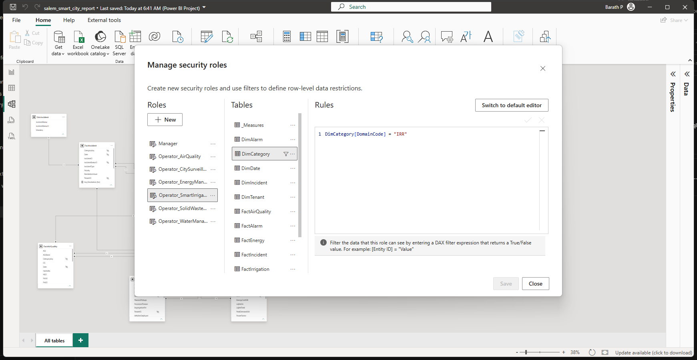
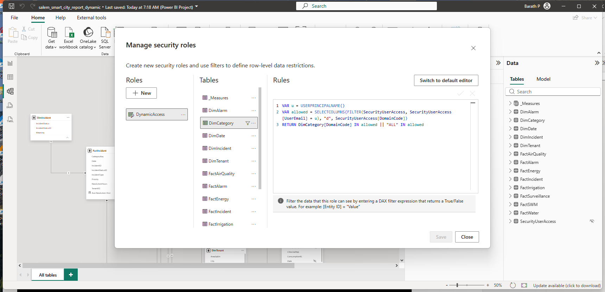
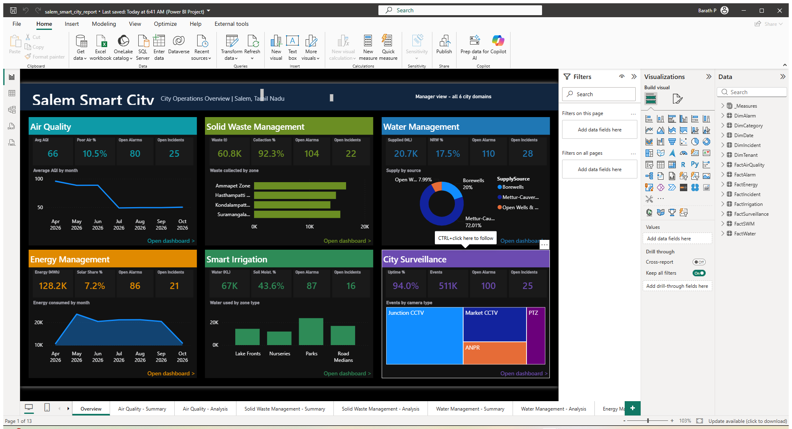
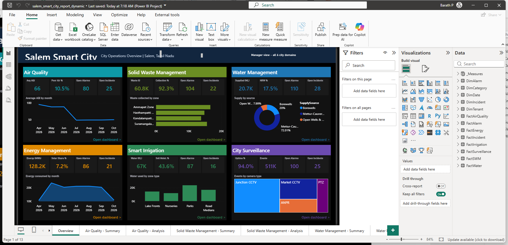
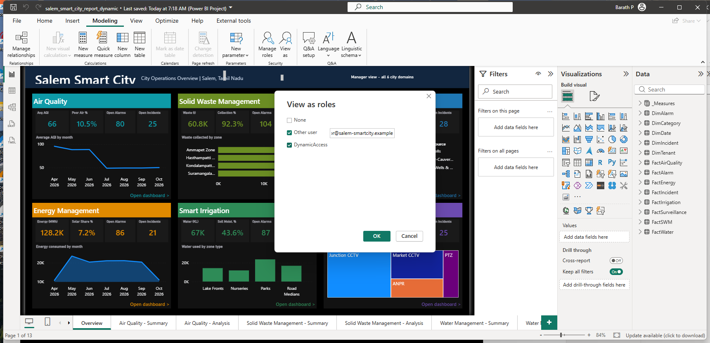
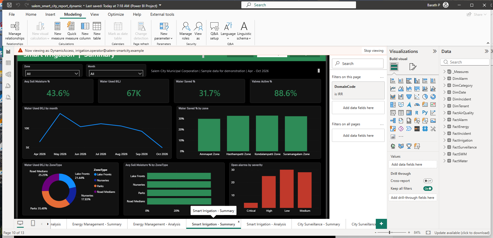
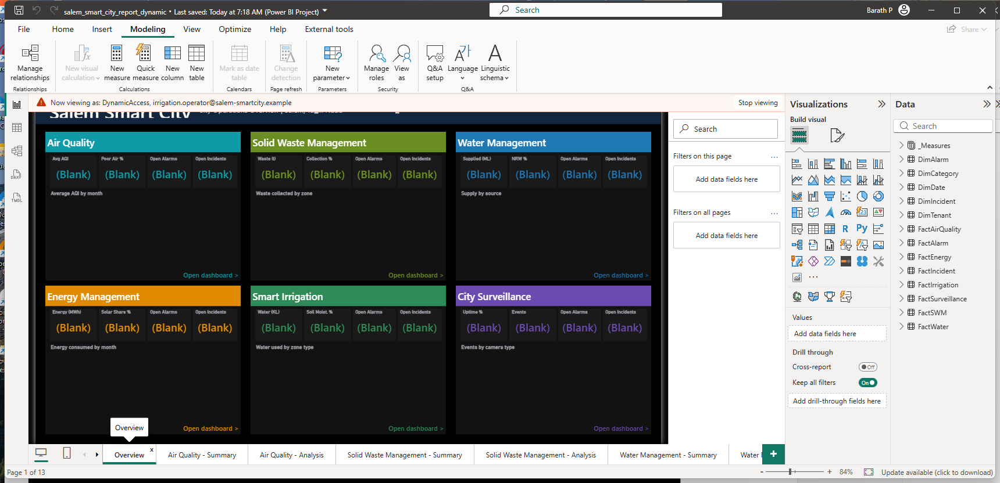
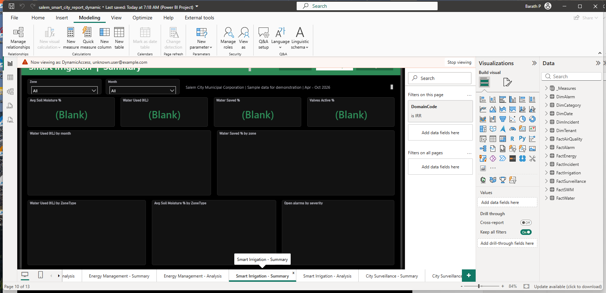

# Who sees what? Row-level security in Power BI, explained with a smart-city dashboard

Imagine you run the control room for a city. A manager wants one screen with everything. An irrigation operator should only ever see irrigation. Same report, same data, different people, different answers.

That is what **row-level security (RLS)** does: it decides which *rows* of data each person can see. This page walks through two ways of building it in Power BI, using a sample report for **Salem, Tamil Nadu**. No programming is needed, only Power BI Desktop.

> The data is sample data made for this demo. The zone names are real Salem Corporation zones; the numbers are not real.

## The story

The report covers six city domains: **Air Quality, Solid Waste, Water, Energy, Smart Irrigation and City Surveillance**.

- **Managers** open an **Overview** page with six cards, one per domain, and can click into any domain.
- **Operators** get only their own domain's two pages (Summary and Analysis).

One report, 13 pages. The question is how to make sure an operator never sees another team's data.

## Two ways to do it

| | **Static RLS** | **Dynamic RLS** |
|---|---|---|
| In one line | One role per team, each with a fixed rule | One role that looks you up in a table |
| Roles to manage | 7 | 1 |
| Add a new operator | Add them to a role in the Power BI service | Add a row to a table, refresh |
| Someone covers two domains | Add them to two roles | Add two rows |
| Good for | Few teams that rarely change | Many users, frequent changes |
| Project in this repo | `model/salem_smart_city_report.pbip` | `model/dynamic_rls/salem_smart_city_report_dynamic.pbip` |

Both use the same data model and the same report pages. Only the security is different.

## How the data is organised

Think of a hub with spokes. In the middle are the **facts**: readings, alarms, incidents. Around them are small **lookup tables** (dimensions): which date, which zone, which domain, what an alarm status means.

- `DimCategory` lists the six domains. **This is the table security is applied to.**
- `DimTenant` is the four city zones.
- `DimDate` is the calendar.
- `DimAlarm` (1 = Open, 2 = Abandoned) and `DimIncident` (5 = Open, 3 = Closed, 7 = In Progress) explain the status codes.
- Eight fact tables hold the readings, alarms and incidents. **All of them connect to `DimCategory`.**

That last point is the trick. When you restrict `DimCategory` to one domain, Power BI automatically restricts every connected fact table too, including alarms and incidents. One rule secures everything. Details are in [`../docs/data-model.md`](../docs/data-model.md).

## Before you start

1. In Power BI Desktop, go to **File > Options and settings > Options > Preview features** and turn on **Power BI Project (.pbip)**, **TMDL** and **PBIR**. Restart Desktop.
2. **File > Open report > Browse**, and pick one of the `.pbip` files above.
3. If it asks for `DataFolder`, type the full path of the matching `data` folder, ending with a backslash. You can change it later under **Home > Transform data > Edit parameters**.
4. Click **Refresh**.

---

## Part 1: Static RLS, step by step

**The idea:** write one rule per team, such as "this role may only see Irrigation".

1. On the **Modeling** tab, click **Manage roles**, then **New**.
2. Name it `Operator_SmartIrrigation`.
3. Pick the `DimCategory` table and set its filter to:

   ```dax
   DimCategory[DomainCode] = "IRR"
   ```
4. Save. Repeat for the other domains:

   | Role | Rule |
   |---|---|
   | `Operator_AirQuality` | `DimCategory[DomainCode] = "AQ"` |
   | `Operator_SolidWasteManagement` | `DimCategory[DomainCode] = "SWM"` |
   | `Operator_WaterManagement` | `DimCategory[DomainCode] = "WTR"` |
   | `Operator_EnergyManagement` | `DimCategory[DomainCode] = "ENG"` |
   | `Operator_SmartIrrigation` | `DimCategory[DomainCode] = "IRR"` |
   | `Operator_CitySurveillance` | `DimCategory[DomainCode] = "SUR"` |

5. Create one more role called `Manager` and **leave every filter empty**. A role with no filter sees everything.

Button names move around between Desktop versions. If you can't find **Manage roles**, look on the **Modeling** tab.

**What you end up with:** seven roles. To move a person to another team, change their role in the Power BI service.

---

## Part 2: Dynamic RLS, step by step

**The idea:** keep a small table of who may see what, and let one role read it.

### Step 1: add the "who sees what" table

1. **Home > Get data > Text/CSV**, and choose `data/security_user_access.csv`. Load it as `SecurityUserAccess`.
2. It looks like this:

   | UserEmail | DomainCode |
   |---|---|
   | manager@... | `ALL` |
   | irrigation.operator@... | `IRR` |
   | shift.supervisor@... | `AQ` |
   | shift.supervisor@... | `ENG` |

   `ALL` means every domain. Someone covering two domains simply gets two rows.
3. **Do not connect this table to anything.** It is only read, never used to filter.
4. Hide it from the report view (right-click > **Hide in report view**).

### Step 2: create the one role

1. **Modeling > Manage roles > New**, name it `DynamicAccess`.
2. On `DimCategory`, use the DAX editor and enter:

   ```dax
   VAR u = USERPRINCIPALNAME()
   VAR allowed =
       SELECTCOLUMNS(
           FILTER(SecurityUserAccess, SecurityUserAccess[UserEmail] = u),
           "d", SecurityUserAccess[DomainCode]
       )
   RETURN
       DimCategory[DomainCode] IN allowed || "ALL" IN allowed
   ```
3. On `SecurityUserAccess`, enter this so nobody can read other people's rows:

   ```dax
   SecurityUserAccess[UserEmail] = USERPRINCIPALNAME()
   ```
4. Save.

### Reading that formula in plain English

1. Find out who is signed in (`USERPRINCIPALNAME()` returns their email).
2. Look in the table for that person's rows and collect their domain codes (`allowed`).
3. For each domain, keep it if it is in their list, **or** if they have the special `ALL`.

### What each person sees

| Signed-in user | Their rows | Domains they see |
|---|---|---|
| manager@... | `ALL` | all 6 |
| irrigation.operator@... | `IRR` | 1 |
| shift.supervisor@... | `AQ`, `ENG` | 2 |
| anyone not in the table | none | **none** |

That last row is a feature: if someone is missing from the table, they see nothing. The safe failure.

---

## How the Overview page knows who you are

The manager Overview should not show data to operators. Two small measures handle that:

```dax
Visible Domains = COUNTROWS(ALL(DimCategory))
Is Manager View = [Visible Domains] >= 6
```

`ALL()` normally ignores filters, but it cannot ignore *security* filters. So a manager gets 6 and an operator gets 1. Every Overview number is wrapped in `IF([Is Manager View], ...)`. Operators see blanks and a message saying the Overview is for managers. The full set of measures is in [`dax/access_measures.dax`](dax/access_measures.dax).

---

## Try it yourself

On the **Modeling** tab, click **View as**. A yellow bar shows who you are pretending to be, and **Stop viewing** puts you back.

| Project | Tick this | You should see |
|---|---|---|
| Static | `Operator_SmartIrrigation` | Irrigation pages have data, other domains are blank, Overview shows the restricted message |
| Static | `Manager` | Everything |
| Dynamic | `DynamicAccess` **and** **Other user**, then type `irrigation.operator@salem-smartcity.example` | Same as the irrigation operator above |
| Dynamic | Same, with `shift.supervisor@salem-smartcity.example` | Air Quality and Energy only |
| Dynamic | Same, with an email that isn't in the table | Nothing |

**The mistake almost everyone makes:** ticking **Other user** without ticking `DynamicAccess`. The email says *who* you are, but the role is what filters. With no role ticked, you see everything.

---

## Going live

1. **Home > Publish** to a workspace.
2. In the Power BI service, open the semantic model and choose **Security**.
3. Add users or groups to the roles (static: each domain role; dynamic: `DynamicAccess`).
4. Give end users **Viewer** access. Workspace Admins, Members and Contributors bypass security, so don't test with them.
5. For dynamic RLS, the emails in the table must be the real sign-in emails of your users. The `@salem-smartcity.example` addresses are for testing in Desktop only.

## What security can't do

RLS hides **rows of data**, not **pages**. An operator can still click the Overview tab; they just see the restricted message. To hide pages properly, publish an app with separate audiences, or give operators a separate report. See also [`../docs/threat-model.md`](../docs/threat-model.md).

## Screenshots

### The model

All eight fact tables connect to the shared lookup tables, so one rule on `DimCategory` secures everything.



### Static RLS: seven roles

Each role holds one fixed rule, for example `DimCategory[DomainCode] = "IRR"`.



### Dynamic RLS: one role

`DynamicAccess` looks the signed-in user up in the hidden `SecurityUserAccess` table.



### The manager Overview

Six domain cards, each with its own chart. Static project first, then dynamic.





### Testing with View as

Tick the role **and** Other user, then type an email from the mapping table.



The irrigation operator sees only irrigation (note the `DomainCode is IRR` filter and the "Now viewing as" bar):



The same operator gets a blank Overview:



An email that is not in the table sees nothing:




## What has been checked

- In Power BI Desktop: both projects open, refresh works, every measure calculates, the static irrigation role showed only irrigation data, and the dynamic rule gave 6, 1, 2 and 0 domains for the manager, irrigation operator, shift supervisor and unknown user.
- Not checked: the Power BI service, apps, embedding, Report Server, and large data volumes.

## Related

- Every table and measure, in readable form: [`../docs/data-model.md`](../docs/data-model.md) and [`../docs/dax-measures.md`](../docs/dax-measures.md)
- The same rules in Apache Superset (a draft): [`../superset/`](../superset/README.md)
- How to think about the risks: [`../docs/threat-model.md`](../docs/threat-model.md)
- A checklist for testing security: [`../docs/testing-checklist.md`](../docs/testing-checklist.md)
