# Apache Superset implementation: Salem Smart City

The same smart-city report as the Power BI project, rebuilt in **Apache Superset 6.1.0 (Docker)** on the same data, with the same two security designs. Thirteen dashboards, six domains, managers see everything and each operator sees only their domain.

> The data is the same synthetic sample data as the Power BI projects. Zone names are the real Salem Corporation zones; the numbers are not real.

## What was built

| Item | Count / detail |
|---|---|
| Dashboards | 13: **Salem Smart City** (Overview) + Summary and Analysis for each of Air Quality, Solid Waste, Water, Energy, Smart Irrigation, City Surveillance |
| Datasets | 8 (one per reporting view), with saved metrics that match the Power BI measures |
| Charts | about 130: KPIs (big number), line, area, bar, donut, treemap, table (the Overview has 20) |
| RLS rules | 7: six static (one per operator role) + one dynamic |
| Roles | `salem_manager`, six `salem_op_*` operator roles, `salem_dynamic` |
| Navigation | Overview cards link to each domain's Summary; every domain dashboard has Home / Summary / Analysis links |

## Screenshots

Manager: the Overview, six domain cards (two KPIs and a different chart type in each) plus open alarms and open incidents by domain.

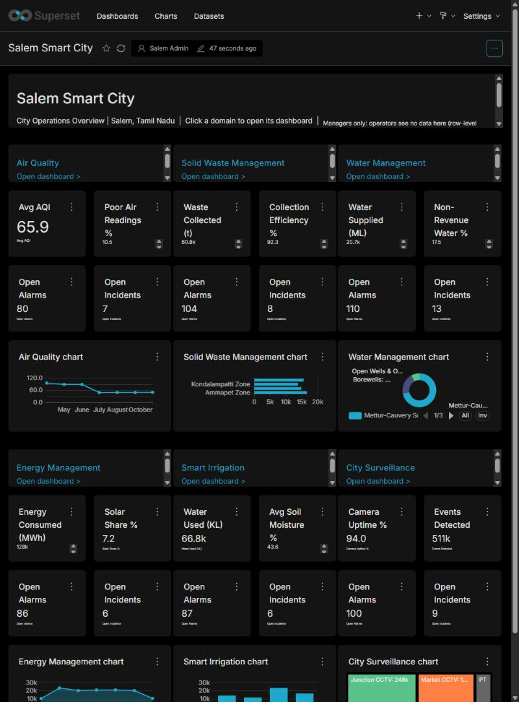

A domain dashboard (Air Quality, Summary and Analysis):

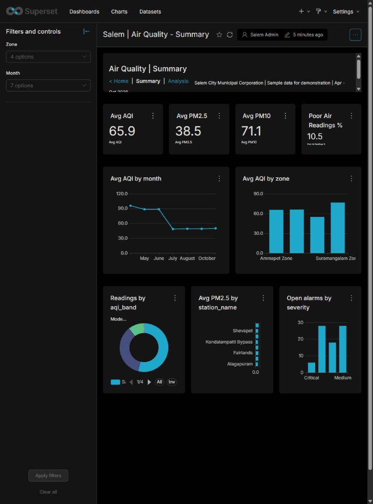

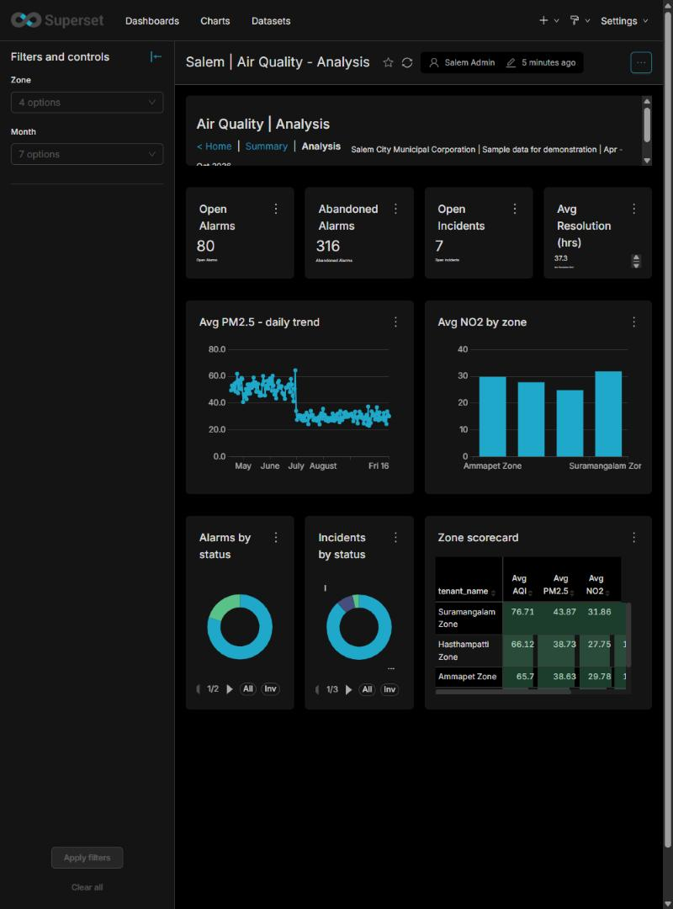

**Static RLS:** the irrigation operator sees Smart Irrigation data...

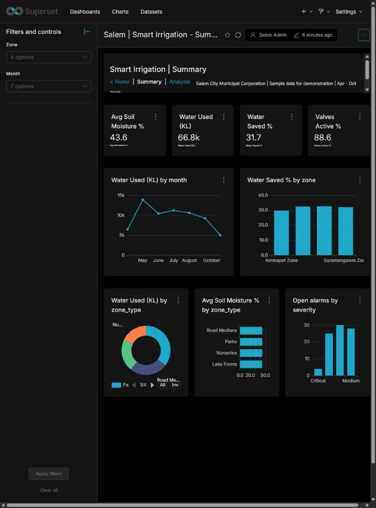

...but on the Air Quality dashboard every chart and filter is empty:

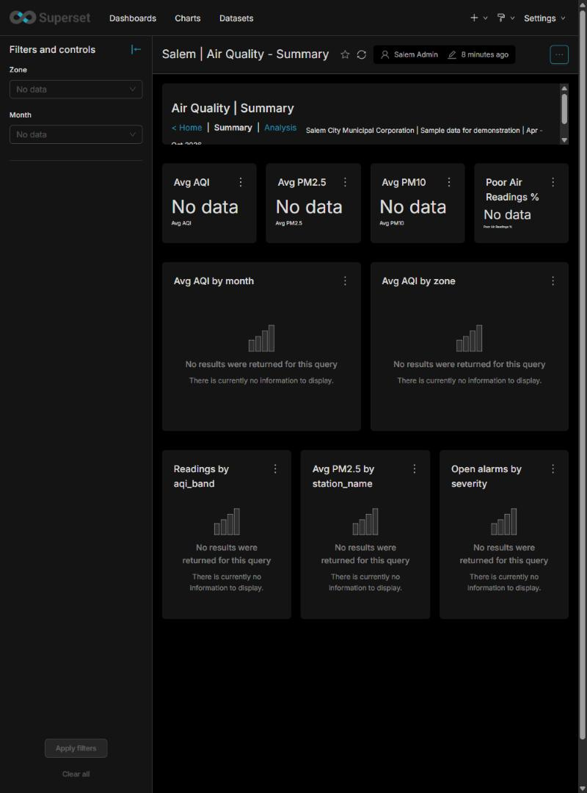

On the Overview, the same operator gets data only on the Smart Irrigation card, and the by-domain charts show only that domain:

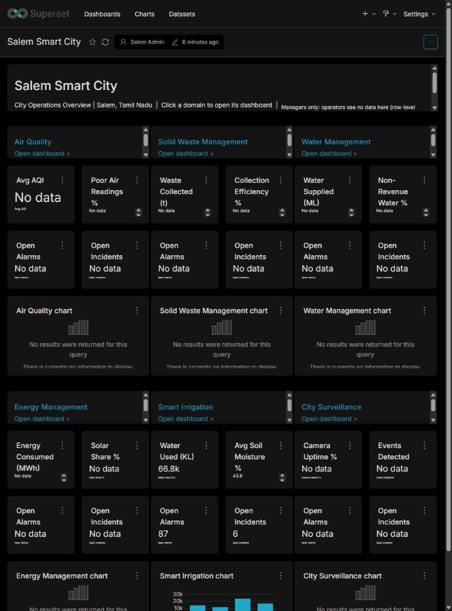

**Dynamic RLS:** a shift supervisor mapped to Air Quality and Energy sees exactly those two cards:

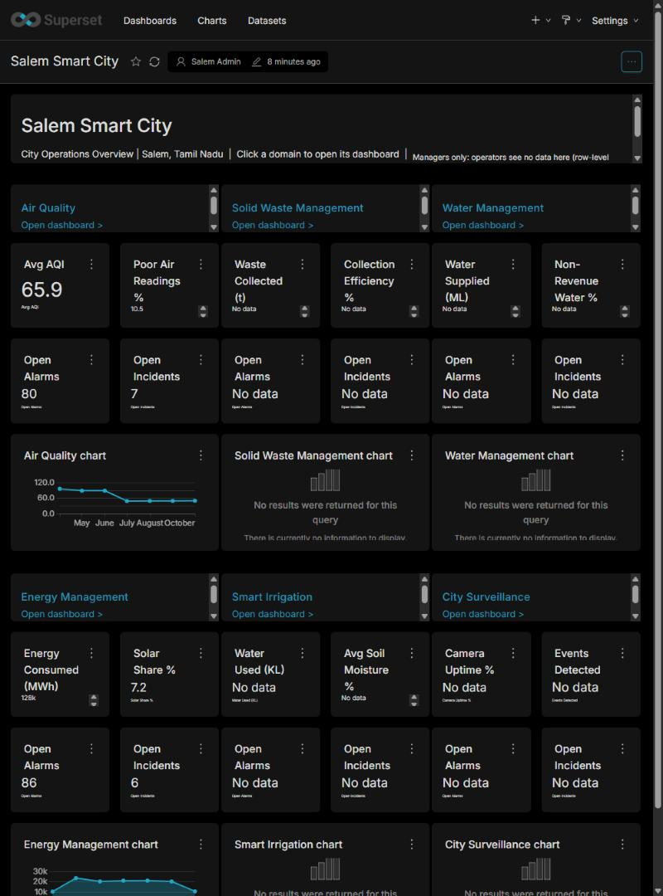

## How the data is organised

PostgreSQL holds the dimension and fact tables from the Power BI model plus the `security_user_access` mapping. Eight **views** join each fact to its dimensions and expose `domain_code`, `tenant_name`, `month_year` and the alarm/incident status text. Superset datasets are built on those views, and **`domain_code` is the column every RLS rule filters on**.

- Schema and views: [`sql/00_schema_and_views.sql`](sql/00_schema_and_views.sql)
- Loading the CSVs: [`sql/01_load_data.md`](sql/01_load_data.md)
- RLS clauses: [`sql/02_rls_rules.sql`](sql/02_rls_rules.sql)

## The two RLS designs in Superset

Superset RLS lives in **Security > Row Level Security**. A rule has a filter type, the datasets, the roles it applies to, and a SQL clause appended to the query's `WHERE`.

| | Static | Dynamic |
|---|---|---|
| Rules | 6 Regular rules, one per operator role | 1 Regular rule for the `salem_dynamic` role |
| Clause | `domain_code = 'IRR'` | looks the user up in `security_user_access` using the Jinja macro `current_user_email()` |
| Add or move an operator | change their role | change a row in the mapping table |
| Needs | nothing special | the `ENABLE_TEMPLATE_PROCESSING` feature flag |

The manager role has no rule, so it sees every domain.

## Test results

Each test user was checked two ways: through the chart data API (which domains come back) and by signing in and opening the dashboards.

| User | Role | Domains visible |
|---|---|---|
| salem_manager | `salem_manager` (no rule) | 6 |
| salem_op_irrigation | `salem_op_irrigation` | 1 (IRR) |
| salem_op_air | `salem_op_air` | 1 (AQ) |
| salem_dyn_manager (manager@...) | `salem_dynamic` | 6 |
| salem_dyn_irrigation (irrigation.operator@...) | `salem_dynamic` | 1 (IRR) |
| salem_dyn_supervisor (shift.supervisor@...) | `salem_dynamic` | 2 (AQ, ENG) |
| salem_dyn_unknown (not in the table) | `salem_dynamic` | 0 |

These match the Power BI results. Irrigation water used for the irrigation operator is 66,834 KL, the same figure the Power BI report shows.

## How Superset differs from Power BI here

- **The Overview is not blank for operators.** Each Overview card is a separate chart on its own dataset, so an operator still sees their own domain's card and "No data" on the rest. In Power BI the Overview measures were wrapped to blank everything for non-managers.
- **RLS applies to datasets, not to people directly.** You attach each rule to datasets and roles. A new dataset needs the rule added or it is unprotected.
- **Admins are not filtered.** Users with the Admin role are not covered by the rules above. Test with a plain role.
- **Hiding a dashboard needs a feature flag.** Per-dashboard role access (`DASHBOARD_RBAC`) was not enabled here, so, as in Power BI, security restricts the data, not which dashboards open.
- **Users need access to the datasets.** Operator roles get the datasource permissions for the Salem datasets only; RLS then narrows the rows.

## Embedding the dashboards in a web page

[`embed/index.html`](embed/index.html) is a single page with two dropdowns, **User** and **Dashboard**, a divider, and the selected dashboard embedded below. Changing either dropdown re-embeds the dashboard for that user. Row-level security is passed in the **guest token** that Superset issues for the embedded session.

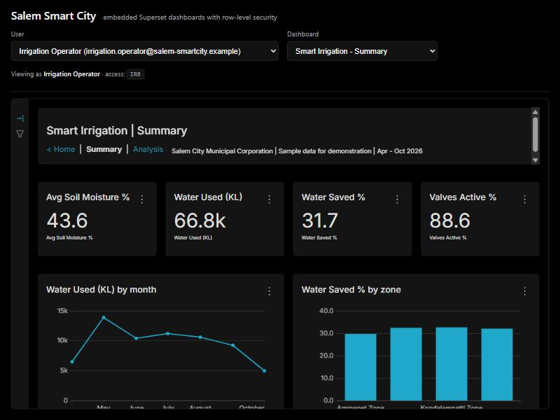

The same dashboard for the Air Quality operator is empty:

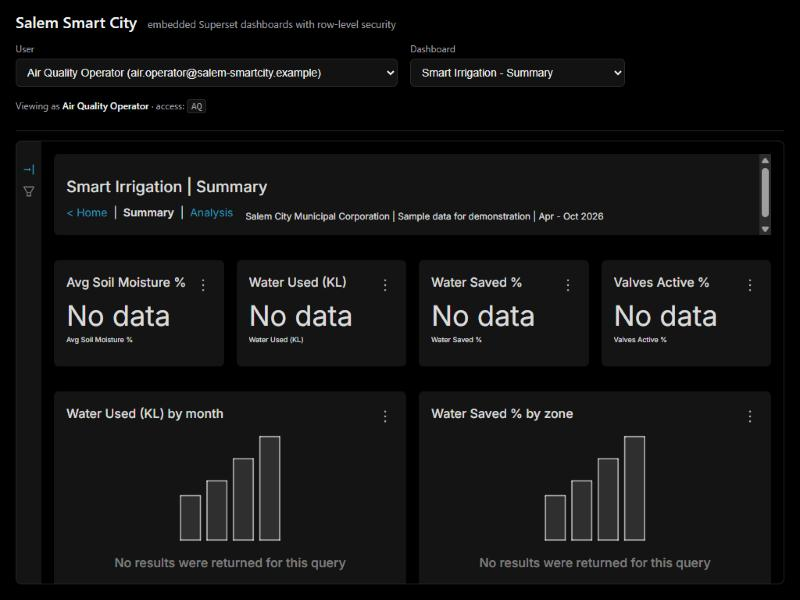

The Overview for the **City Manager** (access: all domains) shows every domain:

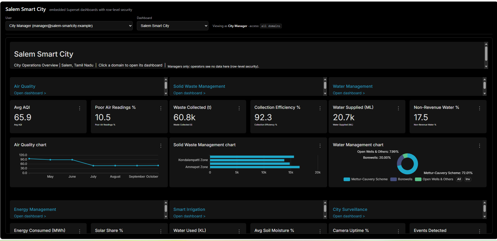

The same Overview for the **Air Quality Operator** (access: `AQ`) shows data only for Air Quality; every other card says "No data":

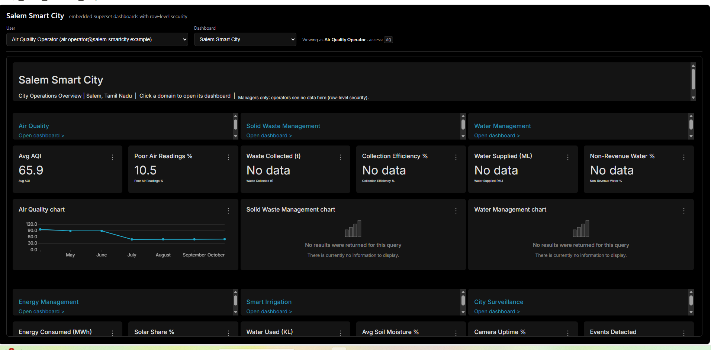

### How it works

1. The page loads the Superset **embedded SDK** and calls `embedDashboard(...)` with the dashboard's embed id.
2. The SDK asks the page for a guest token. The page calls a small helper, `embed/serve.py`, with only the user's email and the dashboard name.
3. The helper logs in with a **service account** and calls `POST /api/v1/security/guest_token/`, sending the dashboard, a user name and an **`rls`** list, for example `[{"clause": "domain_code IN ('AQ', 'ENG')"}]`.
4. Superset adds that clause to every query in the embedded dashboard for that session.

The helper decides the clause itself from `data/security_user_access.csv`, the same mapping used everywhere else: `ALL` gives no clause, a list of domains gives `domain_code IN (...)`, and a user not in the table gets `1 = 0` (no rows). The browser never sends a clause, so it cannot ask for more access. The service password stays in the helper and never reaches the page.

### Setting it up

| Step | What to do |
|---|---|
| Service account | A Superset role with only **`can_grant_guest_token`** and **`can_read`** on `SecurityRestApi`, and one user with that role. It needs no dashboard or data access |
| Enable embedding | For each dashboard call `POST /api/v1/dashboard/{id}/embedded` with `{"allowed_domains": ["http://localhost:4173"]}`. The response holds the embed id, saved in [`embed/dashboards.json`](embed/dashboards.json) |
| Allowed origin | Serve the page from an origin your Superset allows to frame dashboards (its CSP `frame-ancestors` list) and list the same origin in `allowed_domains`. Here it is `http://localhost:4173` |
| Run the helper | `SUPERSET_URL=... SVC_USER=... SVC_PASSWORD=... python embed/serve.py`, then open `http://localhost:4173` |

`embed/dashboards.json` holds embed ids for one Superset instance. Create new ones with the call above when you use another instance.

### Things to know

- **Token timing.** Superset stamps the token's `iat` with fractional seconds, and the SDK checks it straight away, which fails with "token is not yet valid". The helper waits 1.2 seconds before returning the token.
- **Links inside embedded dashboards.** The Home, Summary and Analysis links in the dashboards point to normal Superset pages and do not work inside the embed. Use the Dashboard dropdown.
- **Guest users bypass role rules.** Embedded sessions use the guest role, so the RLS rules in `sql/02_rls_rules.sql` (attached to the `salem_*` roles) do not apply to them. The guest-token `rls` clause is what restricts them.
- **Load time.** The first load takes about a minute on this setup; keep the tab visible.

## Dark theme

The Salem dashboards use Superset's built-in **dark** theme so they stay black whatever the viewer's Light/Dark setting is (the Power BI report is black too). The theme is stored on the dashboard (`theme_id`), and an export zip does not carry it, so set it again after importing.

### Option 1: in the Superset UI

If your instance has theme administration turned on, open the dashboard, **Edit properties**, and pick the dark theme. Many installs do not show this, in which case use option 2.

### Option 2: in the metadata database

Superset keeps its own settings (dashboards, charts, users, themes) in a **metadata database**, separate from your data. Two of its tables matter here:

| Table | What it holds |
|---|---|
| `themes` | The available themes. Superset adds two system themes itself: `THEME_DEFAULT` (light) and `THEME_DARK` |
| `dashboards` | Every dashboard, including a `theme_id` column that points at `themes.id` |

The Salem data lives in a different database (`salem_demo`), so the `themes` table does **not** exist there, and running a query on it in SQL Lab against `salem_demo` fails with `relation "themes" does not exist`. You have to run it against the metadata database, which is not listed in SQL Lab unless someone adds it as a connection.

Run this once the dashboards are imported:

```sql
-- see the themes
SELECT id, theme_name, is_system FROM themes;

-- pin the Salem dashboards to the dark theme
UPDATE dashboards
SET theme_id = (SELECT id FROM themes WHERE theme_name = 'THEME_DARK')
WHERE slug LIKE 'salem-%';

-- check
SELECT slug, theme_id FROM dashboards WHERE slug LIKE 'salem-%' ORDER BY slug;
```

Reload the dashboard in the browser afterwards.

#### How to connect to the metadata database

**A. From the command line (simplest, nothing to configure).** Run `psql` inside the Postgres container that hosts Superset's metadata. Replace the names with yours:

```bash
docker exec -it <postgres-container> psql -U <metadata-user> -d <metadata-database>
```

or run one statement:

```bash
docker exec <postgres-container> psql -U <metadata-user> -d <metadata-database> -c "SELECT id, theme_name FROM themes;"
```

In Superset's stock Docker setup the database, user and password are all `superset`. Yours may differ, so check the Postgres settings in the compose file or its `.env`.

**B. From SQL Lab (adds a connection).** Only do this on a development instance, because it exposes every internal table to SQL Lab users, including user accounts.

1. **Settings > Database Connections > + Database > PostgreSQL.**
2. Enter the host (the Postgres service name, for example `postgres`), port `5432`, the **metadata database name**, and the Postgres **username and password**. A wrong username or password gives "The password provided for username ... is incorrect".
3. Open **Advanced > SQL Lab** and tick **Expose database in SQL Lab**. Tick **Allow DML** as well, or the `UPDATE` is blocked.
4. Choose that connection in SQL Lab and run the SQL above.
5. Delete the connection when you are finished.

If you want less exposure, create a dedicated Postgres user that can read only the two tables you need, and connect with it instead:

```sql
CREATE ROLE theme_reader LOGIN PASSWORD '<choose-one>';
GRANT CONNECT ON DATABASE <metadata-database> TO theme_reader;
GRANT USAGE ON SCHEMA public TO theme_reader;
GRANT SELECT ON themes, dashboards TO theme_reader;
```

That user can read the themes but cannot run the `UPDATE`. Run the `UPDATE` as the main user (option A) or grant `UPDATE (theme_id) ON dashboards` as well.

## Reusing the dashboards

[`dashboards/salem_dashboards_export.zip`](dashboards/salem_dashboards_export.zip) is a Superset export of the 13 dashboards, their charts and datasets, and the database connection (password masked). To import it: create a PostgreSQL database with the schema and data above, then **Settings > Import dashboards**, upload the zip, and enter the database password when asked. Roles, users and RLS rules are not part of an export, so recreate them from `sql/02_rls_rules.sql`.

The dashboards were built on a Superset build with free-form dashboard layout. On stock Superset the six Overview cards stack vertically instead of sitting three across.

## What is verified

- Superset 6.1.0 in Docker: tables and views load, all 13 dashboards render with data, the static and dynamic rules return the results in the table above, and the screenshots come from the running dashboards.
- Not verified: scheduled reports, other Superset versions, large data volumes.
